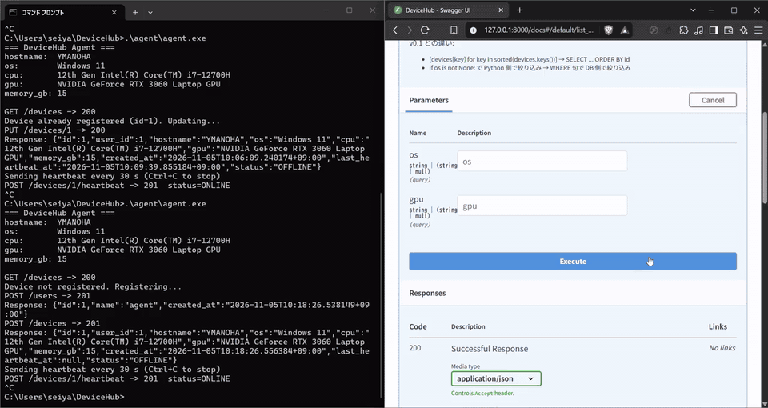

# DeviceHub



*左: C++ のエージェント、右: API の画面(Swagger UI)。空の一覧 → エージェントを起動して登録・heartbeat → `ONLINE` → Ctrl+C で停止 → 60 秒後に `OFFLINE`(待ち時間は 16 倍速)。動画版: [docs/demo.mp4](docs/demo.mp4)*

Windows PC のデバイス情報（ホスト名・OS・CPU・GPU・メモリ）を、C++ 製エージェントが収集し、FastAPI バックエンド経由で PostgreSQL に登録・管理するシステムです。
エージェントは登録後も 30 秒ごとに heartbeat（生存通知）を送り、サーバーは各 PC が **ONLINE / OFFLINE** かを判定します（最後の heartbeat から 60 秒以内なら ONLINE）。

クライアント（C++ / WinHTTP）→ API サーバー（FastAPI）→ DB（PostgreSQL）→ インフラ（Docker / AWS）→ CI（GitHub Actions）まで、Web システムの一通りの層を自分で実装した学習プロジェクトです。

## 構成図

```
Windows PC                          サーバー側
┌──────────────────┐   HTTP/JSON   ┌─────────────────────────┐
│ agent.exe        │ ─────────────▶│ FastAPI (uvicorn :8000) │
│ ・Windows API で │◀───────────── │  ・REST API             │
│   PC情報を収集    │   201/200/404 │  ・APIキー認証           │
│ ・WinHTTP で送信 │               └───────────┬─────────────┘
└──────────────────┘                           │ psycopg
                                               ▼
                                     ┌──────────────────────┐
                                     │ PostgreSQL :5432     │
                                     │  users / devices /   │
                                     │  heartbeats          │
                                     └──────────────────────┘
```

### AWS 構成（本番デプロイ）

```
Windows PC (agent.exe)
      │
      │ HTTP over Internet
      ▼
┌─────────────────────────────────┐
│ VPC                             │
│  ┌───────────┐   ┌────────────┐ │
│  │ EC2       │──▶│ RDS        │ │
│  │ FastAPI   │   │ PostgreSQL │ │
│  └───────────┘   └────────────┘ │
│  Security Group で FW 制御       │
└─────────────────────────────────┘
```

## 技術スタックと選定理由

| 技術 | 用途 | 選定理由 |
|------|------|----------|
| C++ / WinHTTP / Windows API | デバイスエージェント | Windows に標準搭載の API のみで完結させ、追加ライブラリ不要の単一 exe にしたかったため。OS レベルの情報取得（レジストリ・メモリ情報）が直接できる |
| Python / FastAPI | バックエンド API | 型ヒントベースのバリデーション（Pydantic）と Swagger UI の自動生成により、少ないコードで仕様が明確な API を作れるため |
| PostgreSQL / psycopg3 | 永続化 | リレーショナル設計（FK・UNIQUE・CHECK 制約）を業務レベルで扱う練習のため。ORM を使わず生 SQL で書き、制約違反を例外としてハンドリングする設計にした |
| Docker / Docker Compose | 開発・本番環境 | `docker compose up` 一発で API + DB を再現できるようにし、「自分の PC でしか動かない」状態を解消するため |
| AWS（EC2 / RDS / VPC / Security Group） | 本番ホスティング | ローカル PC を切っても動く環境にするため。RDS にすることで DB の運用（バックアップ・パッチ適用）をマネージドに任せる構成を経験した |
| GitHub Actions | CI | push / PR 時に pytest を自動実行し、PostgreSQL サービスコンテナで実 DB を使ったテストを回すため |

## API

Swagger UI で `/docs` から対話的に確認できます。

| メソッド | パス | 説明 | 認証 |
|---------|------|------|------|
| POST | `/users` | ユーザー作成 | APIキー必須 |
| POST | `/devices` | デバイス登録 | APIキー必須 |
| GET | `/devices` | デバイス一覧（`?os=` `?gpu=` で絞り込み可） | 不要 |
| GET | `/devices/{id}` | 個別取得 | 不要 |
| PUT | `/devices/{id}` | 全体更新 | APIキー必須 |
| PATCH | `/devices/{id}` | 部分更新 | APIキー必須 |
| DELETE | `/devices/{id}` | 削除（そのデバイスの heartbeat も消す） | APIキー必須 |
| POST | `/devices/{id}/heartbeat` | 生存通知を記録し、状態つきのデバイスを返す | APIキー必須 |
| GET | `/health` | ヘルスチェック | 不要 |

デバイスを返す API は、すべて `last_heartbeat_at`（最後の heartbeat の時刻。無ければ `null`）と `status`（`ONLINE` / `OFFLINE`）を含みます。
状態は保存せず、取り出すたびに DB の `NOW()` と比べて計算します。「OFFLINE になった」と誰かが書き込む必要がなく、アプリと DB の時計がずれても判定がぶれません。
しきい値は環境変数 `ONLINE_THRESHOLD_SECONDS`（既定 60 秒）で変えられます。

**データを変更する API は、すべて API キーが必要**です（`Authorization: Bearer <キー>`）。
以前は `POST /devices` だけに認証があり、更新・削除は誰でもできてしまっていました（2026/11/05 に修正）。
認証は FastAPI の `Depends`（`require_api_key`）にまとめ、エンドポイントごとの付け忘れを防いでいます。
キーは環境変数 `API_KEY`（16 文字以上のランダムな値）で渡します。**未設定、または短いときは、サーバーが起動しません。** エージェントは、環境変数 `DEVICEHUB_API_KEY`（サーバーと同じ値）から読みます。

### エージェントの動作フロー

```
agent.exe 起動
   │
   ├─ Windows API で hostname / OS / CPU / GPU / RAM を収集
   │
   ├─ GET /devices で自分の hostname が登録済みか確認
   │
   ├─ 未登録 → POST /users → POST /devices (どちらも Authorization: Bearer <key>)
   │
   ├─ 登録済み → PUT /devices/{id} で最新情報に更新 (Authorization: Bearer <key>)
   │  （同じ PC を何度起動しても重複登録されない）
   │
   └─ 30 秒ごとに POST /devices/{id}/heartbeat（Ctrl+C で終了。送信に失敗しても次の回で送り直す）
```

`agent.exe --once` とすると、heartbeat を送らず、登録（または更新）だけで終わります（以前の動作）。

実際に動かした結果（2026/11/05、WSL2 の PostgreSQL のテスト用 DB）:

```
POST /devices -> 201
Sending heartbeat every 30 s (Ctrl+C to stop)
POST /devices/3/heartbeat -> 201  status=ONLINE     ← 3 回送信。この間 GET /devices は ONLINE
（エージェントを停止して 70 秒後）
GET /devices → 3 YMANOHA OFFLINE                       ← 60 秒を超えたので OFFLINE
```

## データベース設計

```
users                    devices                  heartbeats
┌────────────┐           ┌──────────────────┐     ┌────────────┐
│ id      PK │───┐       │ id           PK  │     │ id      PK │
│ name       │   └──────▶│ user_id      FK  │────▶│ device_id FK│
│ created_at │           │ hostname  UNIQUE │     │ created_at │
└────────────┘           │ os               │     └────────────┘
                         │ cpu (NULL可)      │
                         │ gpu               │
                         │ memory_gb CHECK   │
                         │ created_at        │
                         └──────────────────┘
```

設計上のポイント：

- `hostname` に UNIQUE 制約を持たせ、重複登録を DB 側で保証（アプリ側で事前チェックしない）
- `user_id` / `device_id` は FOREIGN KEY で親テーブルの存在を保証
- `memory_gb` は CHECK 制約で `> 0` を強制
- 制約違反は psycopg の `UniqueViolation` / `ForeignKeyViolation` を捕捉し、それぞれ 400 / 404 の HTTP エラーに変換
- `heartbeats` は 30 秒ごとに行が増え続けるので、`(device_id, created_at desc)` の索引で、デバイスごとの最新の 1 件を速く探す（`LEFT JOIN LATERAL` で各デバイスの最新時刻を求める）
- デバイスの削除は、`heartbeats` → `devices` の順に、1 つのトランザクションで消す（FOREIGN KEY があるので、逆の順だと消せない）

既にある DB（ローカルや RDS）には、索引を手で追加します: `create index heartbeats_device_created on heartbeats (device_id, created_at desc);`

## Docker 構成

`docker-compose.yml` で 2 サービスを定義しています。

| サービス | イメージ | 役割 |
|----------|----------|------|
| `backend` | Dockerfile からビルド（python:3.12-slim） | FastAPI + uvicorn |
| `db` | postgres:16 | PostgreSQL |

- `pgdata` ボリュームで DB データを永続化
- `schema.sql` を `/docker-entrypoint-initdb.d/` にマウントし、初回起動時にテーブルを自動作成
- `backend` の `DB_URL` は `host=db` — Compose のサービス名でコンテナ間通信
- `API_KEY` は、`.env`（`.env.example` を写して作る。Git には上げない）か環境変数で渡す。未設定だと、`docker compose` がエラーで止まる
- ポート（5432 と 8000）は、`127.0.0.1` だけに開く。付けないと、同じネットワークや、クラウドで動かしたときのインターネットから、DB（パスワードは開発用の値）に届いてしまう

## AWS 構成

※ この構成は、以前の版で構築して動作を確認したものです。今は、AWS 上の環境は使っていません。

- **EC2**: FastAPI をホスティング。ローカル PC をシャットダウンしても API が動き続ける
- **RDS（PostgreSQL）**: マネージド DB。ローカルの PostgreSQL コンテナと同じ `schema.sql` を適用
- **VPC / Security Group**: EC2 は 8000 番（API）を公開、RDS は EC2 の SG からの接続のみ許可し、DB をインターネットに露出しない構成
- **IAM**: 最小権限の考え方に沿って、普段使いのユーザーを root と分離

エージェント側は `API_HOST` を EC2 の IP に変えるだけで、同一コードがローカル／AWS 両方で動きます。

## CI/CD

`.github/workflows/test.yml` で push / PR 時に自動テストを実行しています。

```
push / PR to main
   │
   ▼
actions/checkout
   │
   ▼
setup-python 3.12
   │
   ▼
pip install -r requirements.txt
   │
   ▼
PostgreSQL 16 サービスコンテナ起動（ヘルスチェック付き）
   │
   ▼
schema.sql でテーブル作成
   │
   ▼
pytest test_main.py -v   ← 実 DB への書き込みを含むテスト
```

テストは認証エラー（401。変更系の全エンドポイントと、形の崩れたヘッダー）・バリデーションエラー（422）・404 に加え、ユーザー作成 → デバイス登録 → 一覧取得 → 更新 → 部分更新 → 削除という実 DB を使った結合テスト、heartbeat の ONLINE / OFFLINE の判定（しきい値を 0 秒にして時間切れを再現）までカバーしています（16 件）。

## 苦労した点と解決策

### 1. Docker コンテナから PostgreSQL に接続できない

`backend` コンテナの `DB_URL` を `host=127.0.0.1` にしていたため接続に失敗しました。

- **原因**: コンテナ内の `localhost` はホストではなくコンテナ自身を指す
- **解決**: Compose のコンテナネットワーク上でサービス名 `host=db` を使う。環境変数で `DB_URL` を切り替える設計にして、ローカル開発（WSL2 直起動）と Docker で同じコードを使い回せるようにした

### 2. Windows バージョンが正しく取れない

`GetVersionEx` はマニフェストの互換性設定により Windows 10 の値を返すことがあり、Windows 11 と区別できませんでした。

- **解決**: `ntdll.dll` の `RtlGetVersion` を `GetProcAddress` で動的に取得して呼び出し、ビルド番号（>= 22000 なら Windows 11）で判定

### 3. WinHTTP が localhost に接続できない

デフォルト設定（`WINHTTP_ACCESS_TYPE_DEFAULT_PROXY`）だと Windows のプロキシ設定が使われ、プロキシ環境では `127.0.0.1` への接続すら失敗します。

- **解決**: `WINHTTP_ACCESS_TYPE_NO_PROXY` を指定して常に直接接続するようにした

### 4. C++ に標準 JSON ライブラリがない

追加ライブラリを入れず単一 exe に収めたかったため、JSON を手組み立てしています。

- **解決**: `"` と `\` をエスケープする `json_escape` を実装してリクエストボディを生成。レスポンスは `"hostname":"<自PC名>"` の直前の `"id":` を探す簡易パーサーで対応（入力が FastAPI の固定フォーマットに限られるため許容と判断）

### 5. v0.1（メモリ内辞書）から PostgreSQL への移行

v0.1 では Python の辞書で保持し、重複チェック・存在チェックを `for` ループと `if` で自前実装していました。

- **解決**: UNIQUE / FOREIGN KEY / CHECK 制約にロジックを委譲し、アプリ側は psycopg の例外を HTTP エラーに写像するだけに簡素化。サーバー再起動でデータが消える問題も解消

### 6. 更新・削除に認証がなかった（2026/11/05 に修正）

API 表を見直したとき、認証があるのは `POST /devices` だけで、`PUT` / `PATCH` / `DELETE` と `POST /users` は、キーなしで誰でも呼べる状態だと気づきました。
登録だけ守っても、更新や削除が開いていれば、データは守れていません。また、`Authorization` ヘッダーが `Bearer <キー>` の形でないと、`split(" ")[1]` が例外を投げて 500 になっていました。

- **解決**: 認証チェックを `require_api_key` にまとめ、変更系のすべてのエンドポイントに `dependencies=[Depends(require_api_key)]` で付けた。形の崩れたヘッダーも 401 にした。エージェントの `POST /users` と `PUT` にもキーを付けた
- **確認**: キーなしの変更系がすべて 401 になるテストを追加し、13 件すべて通った。実際のサーバー（WSL2 の PostgreSQL、テスト用の DB）に対して、エージェントを 2 回実行し、1 回目は登録（`POST /devices -> 201`）、2 回目は更新（`PUT /devices/1 -> 200`）になることを確かめた。キーなしの `PUT` / `DELETE` は 401

### 7. heartbeat と ONLINE / OFFLINE（2026/11/05 に実装）

計画（11〜12 週）にあった「30 秒ごとの heartbeat」と「60 秒で OFFLINE」が、テーブルだけで動いていませんでした。

- **状態を保存しない**: `status` 列を作って更新する方法だと、「止まったエージェント」は自分で OFFLINE と書けないので、別の見張り役が要る。そこで、最後の heartbeat の時刻だけを記録し、取り出すたびに DB の `NOW()` と比べて判定するようにした
- **削除が失敗する問題**: heartbeat の行があるデバイスは、FOREIGN KEY のために削除できなくなる。`heartbeats` を先に消し、2 つの DELETE を 1 つのトランザクションにまとめた
- **確認**: テストで、登録直後 OFFLINE → heartbeat で ONLINE → しきい値切れで OFFLINE → 削除できる、を確かめた。実機でも、エージェントを止めて 70 秒後に OFFLINE になった（上の「実際に動かした結果」）

### 8. 既定のキーを、コードに書いていた（2026/11/12 に修正）

公開する前にリポジトリを見直して、次のことに気づきました。サーバーの `API_KEY` は、未設定なら学習用の固定値で動くこと。エージェント（`agent.cpp`）には、その値が直接書いてあること。`docker compose` が、DB と API のポートを、そのまま外に開いていること。値がコードに書いてあると、知っている人は誰でも書き込めます。そして、設定を忘れても動いてしまうので、気づけません。

- **解決**: サーバーは、`API_KEY`（16 文字以上）が未設定、または短いと、起動しない（失敗するほうに倒す）。エージェントは、環境変数 `DEVICEHUB_API_KEY` から読む。`docker-compose.yml` は、`.env` から `API_KEY` を必須で受け取る。テストと CI は、テスト専用の値を使う。ポートは `127.0.0.1` だけに閉じた。古い版（v0.1）の控えは、リポジトリから外した
- **確認**: 「鍵が未設定、短いと、起動しない」テストを足して、18 件すべて通った。実際に、サーバーとエージェントを動かして、正しい鍵なら登録（`POST /devices -> 201`）と更新（`PUT -> 200`）ができ、違う鍵や鍵なしなら 401 になることを確かめた
- **残っていること**: 履歴には、昔の学習用の値が残っている。例の値で、本物の環境では使っていない

## 今後の改善点（残課題）

- heartbeat の行は消さないので増え続ける（1 台 30 秒ごと = 1 日 2,880 行）。古い行を定期的に消すか、最新時刻だけを `devices` に持つ設計に変える
- エージェントの更新（PUT）は `user_id` を 1 に固定して送っている。ユーザー 1 が存在しない DB では、更新が 404 になる
- API キーは、環境変数で渡す（コードには書かない）。AWS の Secrets Manager などの、シークレット管理への移行は、まだ
- API キーが 1 つだけで、全員が同じキーを使う（ユーザーごとのキーや、権限の区別はない）
- エージェント ⇔ EC2 間が HTTP 平文 → HTTPS 化（ALB + ACM、またはリバースプロキシ）
- デプロイは手作業 → GitHub Actions からの自動デプロイ（build → push → deploy）への拡張

## セットアップ

```bash
# API キーを作る(PowerShell。16 文字以上のランダムな値)
$b = New-Object byte[] 24; [Security.Cryptography.RandomNumberGenerator]::Create().GetBytes($b); [Convert]::ToBase64String($b)
# → .env.example を .env に写して、API_KEY=<作った値> と書く(.env は Git に上げない)

# Docker で全部起動（API + PostgreSQL）
docker compose up --build

# API ドキュメント
# http://127.0.0.1:8000/docs

# テスト（要 PostgreSQL。API_KEY は、テストが専用の値を使うので、設定しなくてよい）
python -m pytest test_main.py -v

# エージェントのビルド（MSYS2 UCRT64）
g++ -static agent/agent.cpp -o agent/agent.exe -lwinhttp

# エージェントの実行（サーバーと同じ鍵を、環境変数で渡す）
$env:DEVICEHUB_API_KEY = '<サーバーと同じ値>'; agentgent.exe
```

## このプロジェクトで学んだこと

- **ネットワーク**: DNS → TCP → TLS → HTTP の階層を意識しながら、WinHTTP で生の HTTP リクエストを組み立てる経験
- **API 設計**: 200/201/400/401/404/422 の使い分け、PUT（全体更新）と PATCH（部分更新）の違いを実装レベルで理解
- **DB**: 制約を「DB の仕事」として設計に組み込むことでアプリコードが単純になることを実感
- **Docker**: コンテナ・ネットワーク・ボリューム・環境変数による設定の外部化
- **AWS**: EC2 / RDS / VPC / Security Group / IAM を組み合わせた最小構成の本番環境
- **CI**: 実 DB を使うテストを GitHub Actions のサービスコンテナで自動化
